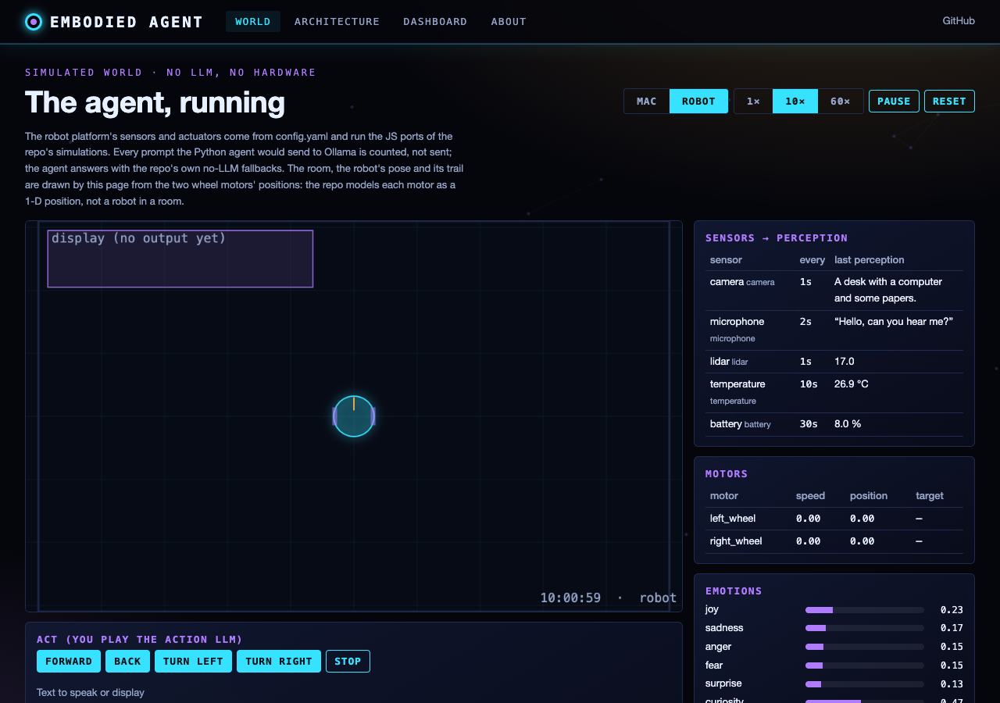
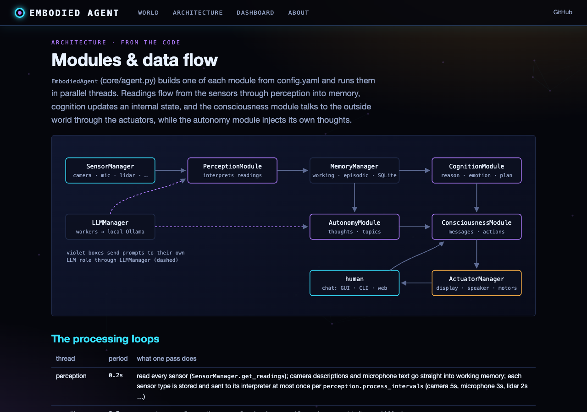
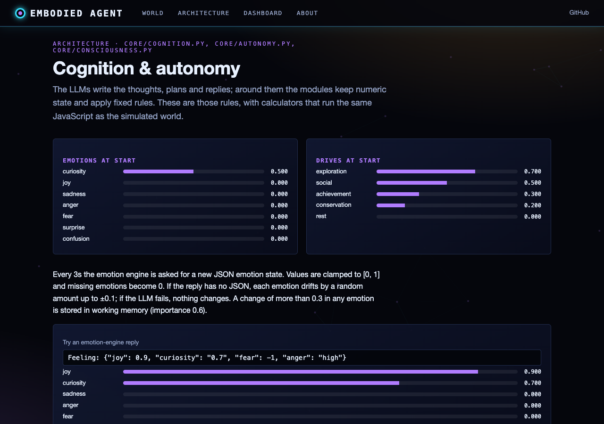

# Embodied AI Agent

An extensible, modular framework for creating embodied AI agents that can interact with the world through various sensors and actuators.

## Overview

This project implements a cognitive architecture for AI agents that aims to model aspects of human cognition, including:

- **Perception**: Processing sensory inputs from cameras, microphones, and other sensors
- **Memory**: Storing and retrieving experiences, knowledge, and working memory
- **Cognition**: Reasoning, planning, and emotional processing
- **Consciousness**: A high-level interface with the external world that coordinates actions
- **Autonomy**: Self-directed thinking, curiosity-driven learning, and conversation initiation

The architecture is designed to be flexible and adaptable to different hardware platforms, from desktop computers to physical robots.

## Key Features

- **Modular Design**: Each component can be developed and tested independently
- **Multi-LLM Architecture**: Uses specialized LLMs for different cognitive functions
- **Hardware Abstraction**: Adapts to available sensors and actuators on different platforms
- **Memory Systems**: Includes working memory, episodic memory, and semantic memory
- **Simulated Hardware**: Provides simulated sensors and actuators for testing and development
- **Autonomous Thinking**: Generates internal thoughts, questions, and reflections
- **Proactive Communication**: Can initiate conversations based on interests and curiosity

## Project Structure

```
embodied_agent/
├── core/                   # Core cognitive modules
│   ├── agent.py           # Main agent orchestration
│   ├── autonomy.py        # Autonomous thinking capabilities
│   ├── consciousness.py   # "Conscious" interface LLM
│   ├── perception.py      # Sensory processing modules
│   ├── cognition.py       # Reasoning, emotions, planning
│   └── memory.py          # Memory management system
├── hardware/               # Hardware interfaces
│   ├── sensors.py         # Sensor interface abstraction
│   ├── actuators.py       # Output/action interfaces
│   └── adapters/          # Hardware-specific implementations
│       ├── mac_adapters.py
│       └── robot_adapters.py
├── llm/                    # LLM handling
│   ├── manager.py         # LLM orchestration and threading
│   └── models.py          # Model definitions and interfaces
├── utils/                  # Utility modules
│   ├── config.py          # Configuration management
│   └── logging.py         # Logging utilities
├── memory/                 # Memory storage
│   ├── episodic/          # Episodic memory storage
│   ├── semantic/          # Semantic memory storage
│   └── output/            # Output logs
├── logs/                   # Log files
├── main.py                 # Application entry point
├── enhanced_chat.py        # Enhanced chat interface
├── test_autonomy.py        # Script to test autonomous thinking
└── config.yaml             # Configuration parameters
```

## Installation

1. Clone the repository:
   ```
   git clone https://github.com/yourusername/embodied_agent.git
   cd embodied_agent
   ```

2. Set up the project structure:
   ```
   python init_project.py
   ```

3. Install dependencies:
   ```
   pip install pyyaml requests
   ```

4. Install Ollama for local LLM inference:
   - Visit [Ollama's website](https://ollama.ai/) for installation instructions
   - Pull the llama3 model: `ollama pull llama3`

## Usage

1. Run the agent:
   ```
   python main.py
   ```

2. To use the enhanced chat interface:
   ```
   python enhanced_chat.py
   ```

3. To test autonomous thinking capabilities:
   ```
   python test_autonomy.py --seed-topics
   ```

4. To specify a different configuration file:
   ```
   python main.py -c custom_config.yaml
   ```

5. To run on a specific hardware platform:
   ```
   python main.py --hardware robot
   ```

6. To enable debug mode:
   ```
   python main.py --debug
   ```

## Configuration

The agent is configured through the `config.yaml` file. Some key configuration options:

- **Hardware Platform**: Configure sensors and actuators for different platforms
- **LLM Models**: Configure which models to use for different cognitive functions
- **Processing Intervals**: Set how frequently different modules should run
- **Memory Settings**: Configure memory capacities and storage
- **Autonomy Settings**: Configure autonomous thinking behavior and conversation initiation

## Autonomous Capabilities

The agent now features advanced autonomous thinking capabilities including:

- **Self-directed thinking**: The agent can generate its own thoughts without external prompting
- **Multiple thinking modes**: Analytical, creative, reflective, exploratory, etc.
- **Curiosity-driven learning**: Develops interests in topics and formulates questions
- **Metacognition**: Reflects on its own thinking processes and patterns
- **Conversation initiation**: Can proactively start conversations based on its interests

These capabilities enable the agent to exhibit more human-like cognitive behavior, including:

- Developing and exploring interests without external direction
- Creating coherent internal narrative threads through related thoughts
- Varying thinking styles based on emotional states and context
- Building rich associations between memories and concepts
- Engaging in conversations in a more natural, less reactive way

## Extending

### Adding New Sensors

1. Implement a new sensor class that extends `SensorInterface`
2. Add the sensor to the configuration file
3. Update perception handling for the new sensor type if needed

### Adding New Actuators

1. Implement a new actuator class that extends `ActuatorInterface`
2. Add the actuator to the configuration file
3. Update action handling for the new actuator type if needed

### Adapting to a New Platform

1. Create a new adapter module in `hardware/adapters/`
2. Add platform-specific sensor and actuator implementations
3. Create a configuration section for the new platform

### Extending Autonomy

1. Add new thinking modes to the `AutonomyModule`
2. Implement custom topic selection or interest development algorithms
3. Create new memory consolidation methods for autonomous thoughts

## How It Works

The agent operates through several parallel processing loops:

1. **Perception Loop**: Polls sensors, processes the data with specialized LLMs
2. **Cognition Loop**: Reasons about perceptions, updates emotional state, plans actions
3. **Consciousness Loop**: Processes external communications, maintains internal monologue
4. **Autonomy Loop**: Generates autonomous thoughts, manages curiosity and interests
5. **Memory Consolidation**: Periodically consolidates important memories

Data flows from perception through cognition to consciousness, with memory systems storing and providing context along the way. The autonomy module operates in parallel, injecting internally generated thoughts into the consciousness module.

## License

This project is licensed under the MIT License - see the LICENSE file for details.

## Acknowledgments

- Inspired by various cognitive architectures and research in artificial general intelligence
- Built using Ollama and LLM models for cognitive processing


---
*Built with AI assistance from [Claude (Anthropic)](https://claude.com/).*

## Web interface and static site

**Live:** https://gddickinson.github.io/ai_agent/ (published from `main` by `.github/workflows/pages.yml`)

| Simulated world | Modules & data flow | Cognition & autonomy |
|---|---|---|
|  |  |  |

The static site never calls an LLM. Its **simulated world** runs JavaScript ports of the framework's non-LLM logic:
the simulated sensors, per-type perception intervals, working memory, emotion parsing and drift, thinking-mode and
topic-interest rules, conversation-initiation odds, regex fact extraction, the simulated motor model and
`ActuatorManager` routing. Node tests (`web/static/*.test.mjs`) hold each port to values computed by the Python code
(`scripts/make_engine_fixture.py` → `tests/fixtures/engine_fixture.json`). Where the agent would prompt Ollama, the
simulator counts the prompt and takes the repo's own no-LLM path (fallback reply, fallback conversation starter). The
room and the robot's pose are drawn from the two wheel motors' positions; the repo itself models each motor in 1-D.
The architecture pages are generated from the code (modules parsed with `ast`, the schema created by `MemoryManager`,
defaults read from the modules).

### Run the web app

```bash
pip install -r requirements-web.txt
python run_web.py            # http://127.0.0.1:8132
```

Locally, the **Dashboard** starts the real `EmbodiedAgent` (all sensors forced to simulation), lets you chat with it
and send actions, shows its monologue, emotions, topics, working memory and LLM queue, checks which configured models
your Ollama server has, browses `memory/memory.db` (read-only) and tails the display/speaker output files. LLM calls go
only to the `api_base` in `config.yaml` (localhost). None of the memory database or logs is exported to the static site.

```bash
python -m pytest -q tests                       # unit + web tests (no hardware, no network)
python scripts/make_engine_fixture.py           # after changing the ported logic
python scripts/build_static.py --out site       # static site
python scripts/screenshots.py --static "" world  # browser smoke test
```
